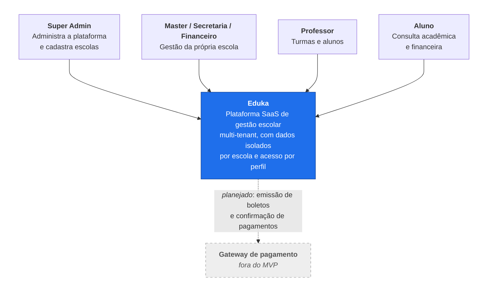
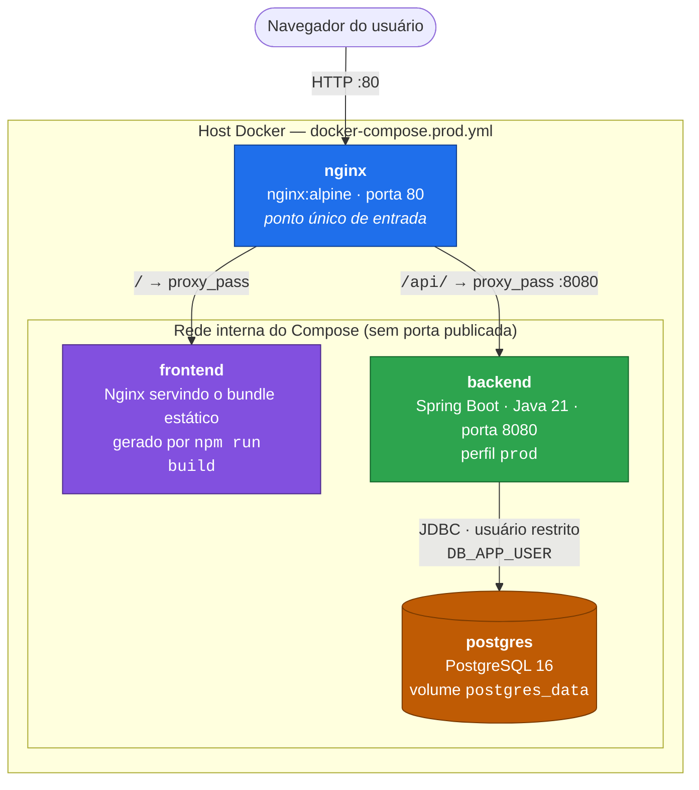
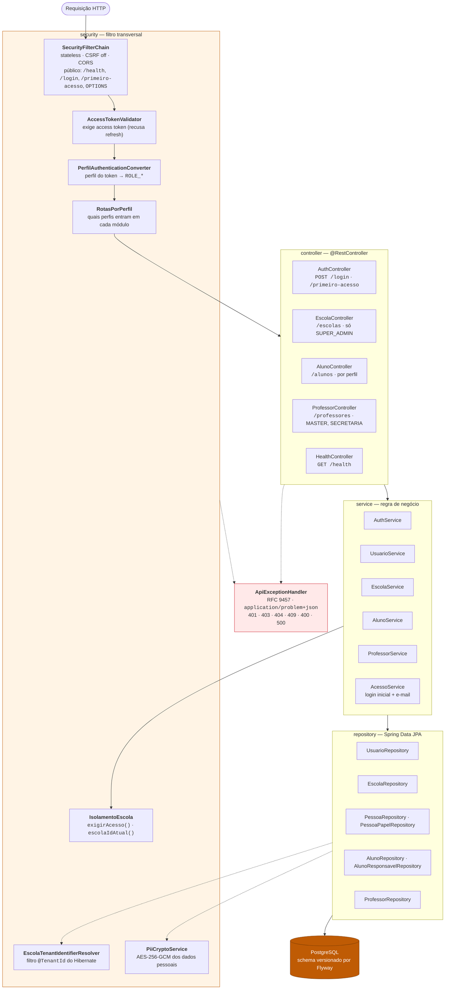
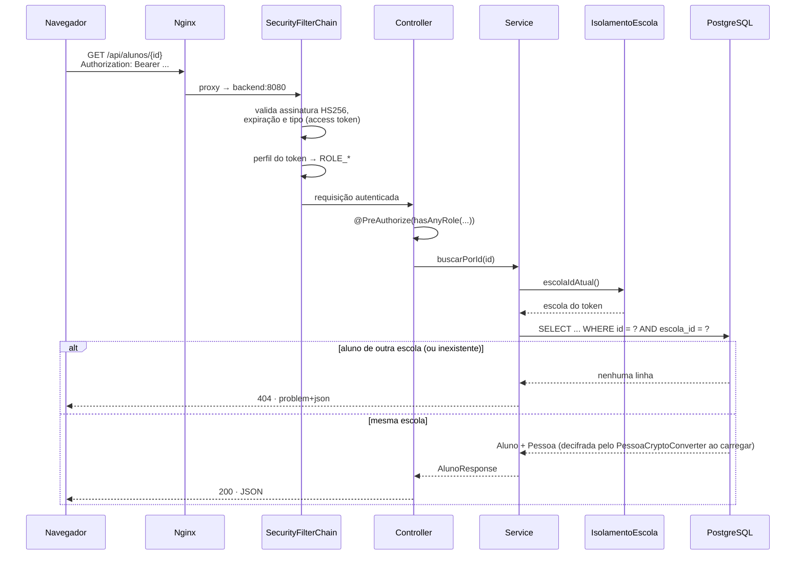
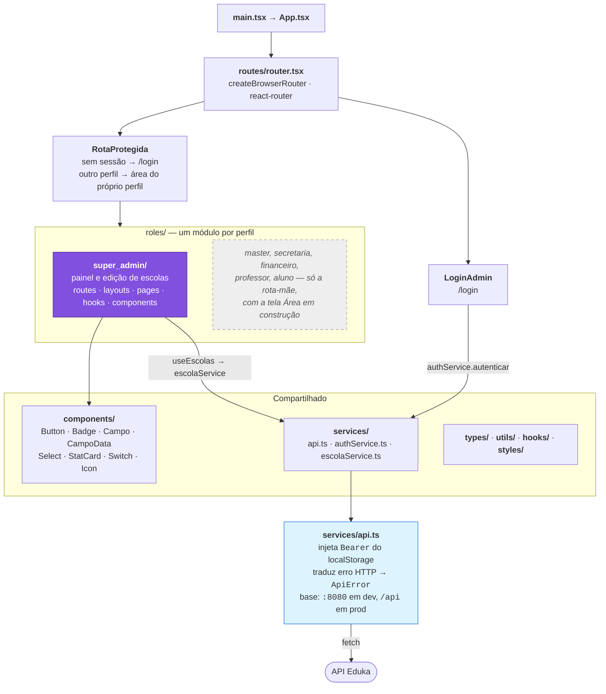

# Arquitetura da Solução — Eduka

Mapeamento da arquitetura do Eduka, plataforma SaaS multi-tenant de gestão escolar.
Os diagramas seguem a notação [C4 Model](https://c4model.com) (contexto, containers e componentes)
e estão em Mermaid, renderizado nativamente pelo GitHub.

> Este documento descreve a arquitetura **como implementada** no código deste repositório.
> Itens ainda não implementados estão marcados como *planejado*.

---

## 1. Visão geral

O Eduka é uma aplicação web de três camadas físicas, empacotada em containers Docker:

| Camada | Tecnologia | Onde fica |
|---|---|---|
| Cliente | SPA React 19 + TypeScript, build com Vite | `Codigo/frontend/` |
| Aplicação | API REST stateless, Spring Boot 4 / Java 21 | `Codigo/backend/` |
| Dados | PostgreSQL 16, migrações versionadas com Flyway | `Codigo/backend/src/main/resources/db/migration/` |

Duas características definem a arquitetura:

1. **Multi-tenant com isolamento lógico.** Uma única instância da aplicação e um único banco
   atendem todas as escolas. A separação é por coluna `escola_id` nas tabelas de negócio, validada
   em tempo de execução (ver [§5](#5-isolamento-multi-tenant)).
2. **API stateless autenticada por JWT.** Não há sessão nem cookie no servidor; toda requisição
   carrega o próprio contexto de autenticação no header `Authorization`.

---

## 2. Diagrama de contexto (C4 — Nível 1)

Quem usa o sistema e com o que ele conversa.

No MVP o Eduka é um sistema fechado: **não há integração com sistemas externos**. Cobranças,
pagamentos e despesas são de registro manual. O gateway de pagamento aparece acima apenas para
sinalizar o ponto de extensão previsto no Documento de Visão.

---

## 3. Diagrama de containers (C4 — Nível 2)

### 3.1 Ambiente de produção

Ponto único de entrada: um Nginx na porta 80 serve o frontend compilado e faz proxy das chamadas
de API. Frontend, backend e banco não publicam portas para o host.

Como front e API são servidos na **mesma origem**, o CORS em produção fica vazio: nenhuma origem
externa é aceita. O roteamento do React Router funciona porque o Nginx do container `frontend`
faz `try_files ... /index.html`.

### 3.2 Ambiente de desenvolvimento

Sem Nginx: cada serviço publica sua porta e o Vite chama o backend diretamente, com o CORS
liberando `http://localhost:5173`.

O container Postgres executa `Codigo/postgres/init/01-create-app-role.sh` na primeira subida,
criando o role restrito `DB_APP_USER` — o backend **nunca** conecta como superuser.

Também só em dev, o serviço `mock` espera o backend aplicar as migrations, carrega as escolas de
exemplo de `Codigo/postgres/mock/mock.sql` e encerra. O super admin de dev é criado pelo
`DevDataSeeder` do backend (perfil `dev`), via JPA, para que os dados pessoais passem pela
criptografia.

---

## 4. Componentes do backend (C4 — Nível 3)

Arquitetura em camadas clássica: `controller` → `service` → `repository` → banco. O pacote
`security` é transversal e o `exception` padroniza todas as respostas de erro.

### Superfície da API hoje

| Método | Rota | Perfis autorizados |
|---|---|---|
| `GET` | `/health` | público |
| `POST` | `/login` | público |
| `POST` | `/primeiro-acesso` (troca a senha provisória pela definitiva) | público |
| `GET` | `/escolas` · `/escolas/{id}` | `SUPER_ADMIN` |
| `POST` | `/escolas` | `SUPER_ADMIN` |
| `PUT` | `/escolas/{id}` | `SUPER_ADMIN` |
| `PATCH` | `/escolas/{id}/ativar` · `/suspender` | `SUPER_ADMIN` |
| `GET` | `/alunos` · `/alunos/{id}` | `MASTER`, `SECRETARIA`, `FINANCEIRO`, `PROFESSOR` |
| `POST` | `/alunos` | `MASTER`, `SECRETARIA` |
| `GET` | `/professores` · `/professores/{id}` | `MASTER`, `SECRETARIA` |
| `POST` | `/professores` | `MASTER`, `SECRETARIA` |
| `PUT` | `/professores/{id}` | `MASTER`, `SECRETARIA` |
| `DELETE` | `/professores/{id}` (inativa) | `MASTER`, `SECRETARIA` |
| `PATCH` | `/professores/{id}/ativar` | `MASTER`, `SECRETARIA` |
| `POST` | `/professores/{id}/primeiro-acesso` (reenvia o e-mail) | `MASTER`, `SECRETARIA` |

Qualquer rota não listada como pública exige `Authorization: Bearer <access token>` e responde
`401` sem ele. Perfil sem permissão recebe `403`.

A autorização tem duas camadas. `RotasPorPerfil`, aplicada no filter chain, define quais perfis
entram em cada módulo pelo prefixo da rota (`/escolas`, `/alunos`, `/cobrancas`...). Módulos que
ainda não têm controller já estão na lista, de modo que o endpoint nasce protegido. Dentro do
módulo, o controller refina por ação com `@PreAuthorize` e as constantes de `Perfis`
(ex.: `/alunos` é lido por quatro perfis, mas só `MASTER` e `SECRETARIA` cadastram).

---

## 5. Isolamento multi-tenant

O ponto arquitetural mais sensível do sistema. A regra é uma só:

> **A escola do usuário vem do token, nunca de parâmetro da requisição.**

O isolamento tem duas camadas:

1. **Services.** Consultas filtram por `IsolamentoEscola.escolaIdAtual()` em vez de aceitar um
   `escolaId` do cliente. Quando o recurso é carregado por outro caminho,
   `IsolamentoEscola.exigirAcesso(escolaIdDoRecurso)` responde `403` se ele for de outra escola.
2. **Persistência.** Entidades com o campo de escola anotado com `@TenantId` (hoje `Aluno`)
   recebem `escola_id = <escola do token>` automaticamente do Hibernate em toda consulta, e o
   campo é preenchido sozinho no insert. O tenant vem do `EscolaTenantIdentifierResolver`. Sem
   escola no contexto (login, subida da aplicação, `SUPER_ADMIN`), ele devolve um id que não
   corresponde a nenhuma escola, então as consultas voltam vazias: o isolamento é fechado por
   padrão.

`SUPER_ADMIN` administra a plataforma, não uma instituição: não pertence a nenhuma escola.
Por isso só acessa o cadastro das escolas (`/escolas`, `/planos`) e os usuários vinculados a
elas (`/usuarios`); os módulos de negócio (acadêmico, financeiro, relatórios) o barram com `403`.

**Dados pessoais.** Nome, CPF, data de nascimento, e-mail, telefone e endereço ficam na tabela
`PESSOA`, em colunas `BYTEA` cifradas com AES-256-GCM pela aplicação (`PessoaCryptoConverter` e
`PiiCryptoService`). A chave `PII_ENCRYPTION_KEY` fica só na JVM: o Postgres nunca vê texto puro
nem a chave. Alunos e seus responsáveis apontam para registros de `PESSOA`.

**Perfis de acesso** (`PerfilUsuario`): `SUPER_ADMIN`, `MASTER`, `SECRETARIA`, `FINANCEIRO`,
`PROFESSOR`, `ALUNO`.

---

## 6. Arquitetura do frontend

Organização por **papel de usuário** (`roles/`), e não por tipo de arquivo: cada perfil tem suas
próprias páginas, layouts, componentes e rotas, o que mantém os painéis independentes conforme
novos perfis forem entrando.

O `apiRequest` centraliza autenticação, headers e tratamento de erro — nenhuma tela chama `fetch`
diretamente. Após o `POST /login`, o `authService` grava o access token no `localStorage` (chave
`eduka.accessToken`) e leva o usuário para a área do próprio perfil. O id e o perfil do usuário
são sempre lidos das claims do token, e não de um valor salvo à parte; só o login (e-mail) fica
guardado separadamente. O `RotaProtegida` é só conveniência de navegação: quem garante o acesso é o
backend.

A interface usa apenas tema claro, no estilo "liquid glass" do protótipo, com cores, fontes (Nunito
nos títulos, Figtree no texto) e animações definidas como variáveis em `styles/global.css`. Detalhes em
[`Codigo/frontend/README.md`](../../Codigo/frontend/README.md).

---

## 7. Modelo de dados

O detalhamento das entidades e relacionamentos está no **DER**:
[`Artefatos/der/der_multitenant_escola.jpeg`](../der/der_multitenant_escola.jpeg).

O schema é versionado por migrações Flyway, aplicadas na subida do backend
(`spring.jpa.hibernate.ddl-auto=validate` — o Hibernate valida, nunca altera o schema):

| Migração | O que faz |
|---|---|
| `V1__criar_estrutura_perfis.sql` | Estrutura inicial: escolas, usuários e perfis |
| `V2__renomear_empresa_para_escola.sql` | Renomeia o conceito de "empresa" para "escola" |
| `V3__tornar_escola_id_opcional.sql` | Torna `escola_id` opcional para `SUPER_ADMIN` |
| `V4__adiciona_versao_escola.sql` | Coluna de versão (bloqueio otimista em Escola) |
| `V5__criar_alunos.sql` | Tabela de alunos |
| `V6__adiciona_plano_escola.sql` | Plano da escola (`BASICO`, `AVANCADO`, `ENTERPRISE`) |
| `V7__detalha_endereco_e_assinatura_escola.sql` | Endereço em campos, vigência da assinatura, limite de usuários e módulos habilitados (`ESCOLA_MODULO`) |
| `V8__descarta_pessoa_antiga.sql` | Remove a tabela `PESSOA` original, que não cifrava os dados |
| `V9__recria_pessoa_cifrada.sql` | Recria `PESSOA` com os dados pessoais em `BYTEA` cifrado |
| `V10__liga_alunos_a_pessoa.sql` | Aluno passa a apontar para `PESSOA`; responsáveis em `ALUNO_RESPONSAVEL` |
| `V11__criar_professor.sql` | Tabela `PROFESSOR`, ligada a `PESSOA` (dados pessoais cifrados) |
| `V12__acesso_inicial_usuario.sql` | Senha provisória em `USUARIO` (flag + validade) e `PROFESSOR.USUARIO_ID` |

---

## 8. Decisões arquiteturais

| # | Decisão | Motivação |
|---|---|---|
| 1 | **Multi-tenant com banco único e isolamento por `escola_id`** | Custo operacional e complexidade de migração muito menores do que um banco por escola; o isolamento é garantido em código por `IsolamentoEscola` e coberto por testes de autorização. |
| 2 | **API stateless com JWT (HS256)** em vez de sessão | Escala horizontalmente sem estado compartilhado; elimina CSRF (sem cookie) e simplifica o deploy. Custo: revogação de token não é imediata. |
| 3 | **`JWT_SECRET` obrigatório, mínimo de 32 bytes** | A aplicação se recusa a subir sem ele. Evita que o sistema entre no ar com chave default conhecida. |
| 4 | **Perfil `prod` sem nenhum valor default** | Variável faltando derruba a subida com `Could not resolve placeholder`, em vez de subir com credencial `changeme`. |
| 5 | **Nginx como ponto único de entrada em produção** | Front e API na mesma origem: CORS deixa de ser necessário e só a porta 80 fica exposta. |
| 6 | **Role de banco restrito (`DB_APP_USER`)** | O backend nunca conecta como superuser do Postgres; o role é criado no bootstrap do container. |
| 7 | **Migrações Flyway + `ddl-auto=validate`** | Schema é versionado e revisável; o Hibernate não altera o banco automaticamente. |
| 8 | **Senhas em BCrypt (custo 12) com prefixo de algoritmo** | O prefixo `{bcrypt}` permite trocar o algoritmo no futuro sem invalidar senhas existentes — hashes antigos são regravados no próximo login. |
| 9 | **Erros em formato único (RFC 9457)** | Todo erro — de filtro de segurança ou de controller — tem o mesmo corpo `{status, title, detail}`; em prod, sem stack trace ou nome de exceção. |
| 10 | **Frontend organizado por papel de usuário** | Cada perfil evolui de forma independente, sem acoplar telas de contextos diferentes. |
| 11 | **Dados pessoais cifrados na aplicação (AES-256-GCM)** | Atende à LGPD mesmo com acesso indevido ao banco ou a um backup: sem a `PII_ENCRYPTION_KEY`, que nunca sai da JVM, os dados pessoais são ilegíveis. Custo: não dá para filtrar por esses campos no SQL. |
| 12 | **Isolamento também no Hibernate (`@TenantId`)** | O filtro por escola deixa de depender de cada service lembrar dele; sem escola no contexto, a consulta volta vazia. |
| 13 | **Autorização por módulo (`RotasPorPerfil`) antes do controller** | Um endpoint novo dentro de um prefixo existente já nasce protegido pelo perfil do módulo. |

---

## 9. Requisitos não funcionais atendidos pela arquitetura

| RNF | Como a arquitetura atende |
|---|---|
| Autenticação | JWT HS256, rotas protegidas por padrão; só `/health`, `/login` e `/primeiro-acesso` são públicas |
| Autorização por perfil | `@PreAuthorize` sobre `ROLE_*` derivado do claim de perfil |
| Isolamento entre escolas | `IsolamentoEscola` nos services e `@TenantId` no Hibernate; escola vem do token |
| Confidencialidade de senha | BCrypt custo 12; a coluna `senha_hash` nunca recebe texto puro |
| Confidencialidade de dados pessoais | `PESSOA` cifrada com AES-256-GCM pela aplicação; o banco nunca vê a chave |
| Não vazamento de informação | Login inexistente, senha errada e usuário inativo devolvem a mesma mensagem |
| Portabilidade de ambiente | Todo o stack sobe por Docker Compose, em dev e em prod |

---

## 10. Pontos em aberto

* **TLS.** Hoje o Nginx de produção escuta em HTTP (porta 80). Certificado e redirecionamento
  para HTTPS ainda não estão configurados.
* **TLS no banco.** `DB_SSLMODE` está preparado como parâmetro, mas o padrão é `disable`;
  o alvo em produção é `verify-full`.
* **Refresh token.** O backend emite e sabe validar refresh tokens, mas ainda não há endpoint
  HTTP de renovação. Quando o access token expira, o usuário precisa fazer login de novo.
* **Painéis dos demais perfis no frontend.** Só o Super Admin tem telas; `MASTER`,
  `SECRETARIA`, `FINANCEIRO`, `PROFESSOR` e `ALUNO` já têm rota-mãe protegida, mas mostram
  "Área em construção".
* **`@TenantId` nas demais entidades.** Hoje só `Aluno` tem o filtro automático do Hibernate;
  as próximas entidades de negócio devem seguir o mesmo padrão. `Pessoa` é exceção proposital:
  o `SUPER_ADMIN` cria pessoas em nome de outras escolas, o que o filtro não expressa. Por isso
  toda leitura de `Pessoa` passa pelos métodos escopados por escola do `PessoaRepository`
  (`findByIdAndEscolaId`, `findAllByIdInAndEscolaId`), nunca por `findById` puro.
* **Demais módulos do MVP.** Professores, cursos, turmas, matrículas, cobranças, pagamentos e
  despesas seguem o mesmo padrão de camadas já estabelecido por Escola e Aluno.
