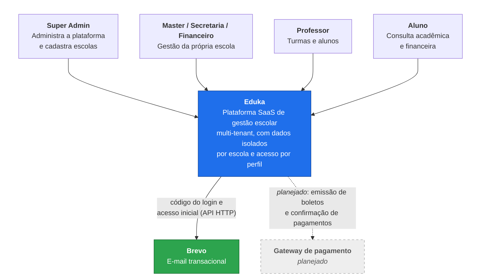
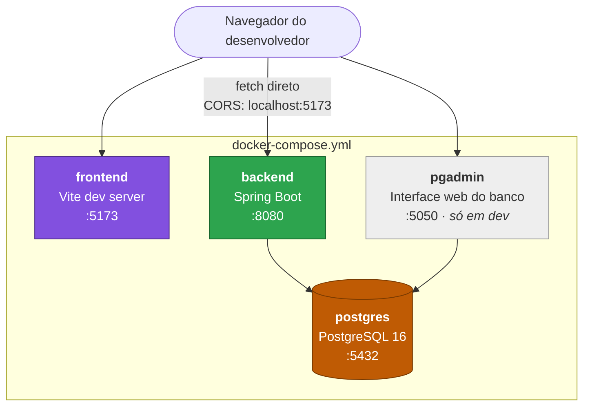
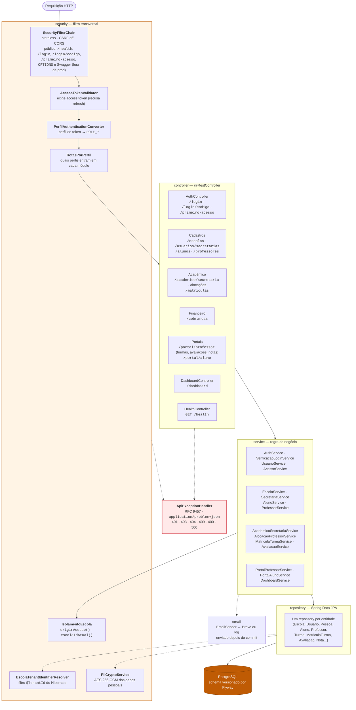
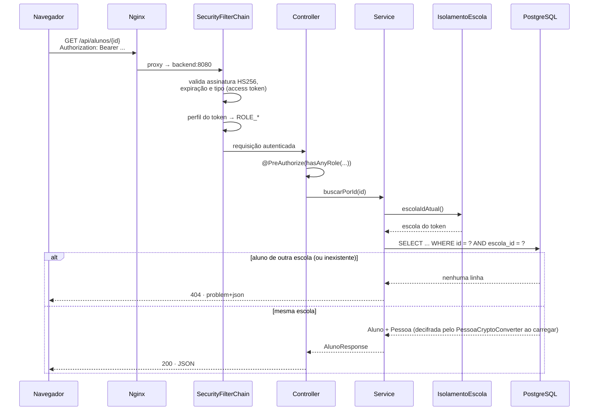
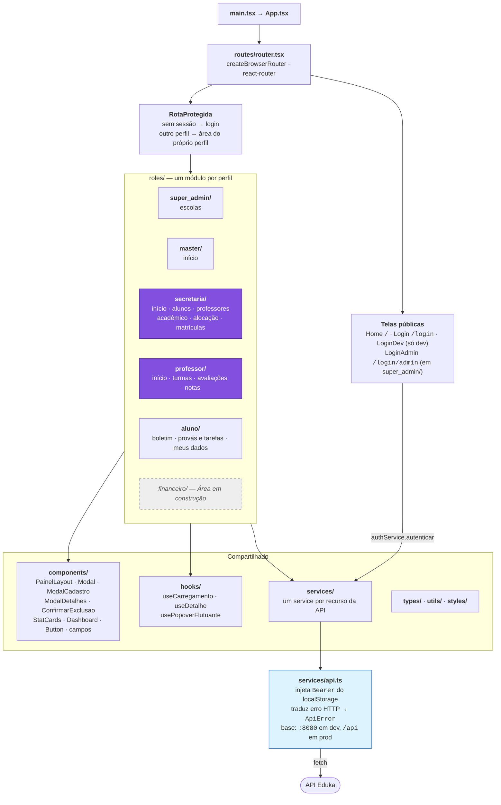

# Arquitetura da Solução — Eduka

Mapeamento da arquitetura do Eduka, plataforma SaaS multi-tenant de gestão escolar.
Os diagramas seguem a notação [C4 Model](https://c4model.com) (contexto, containers e componentes)
e estão em Mermaid, renderizado nativamente pelo GitHub.

> Este documento descreve a arquitetura **como implementada** no código deste repositório.
> Itens ainda não implementados estão marcados como *planejado*.

---

## 1. Visão geral

O Eduka é uma aplicação web de três camadas físicas, empacotada em containers Docker:

| Camada | Tecnologia | Onde fica |
|---|---|---|
| Cliente | SPA React 19 + TypeScript, build com Vite | `Codigo/frontend/` |
| Aplicação | API REST stateless, Spring Boot 4 / Java 21 | `Codigo/backend/` |
| Dados | PostgreSQL 16, migrações versionadas com Flyway | `Codigo/backend/src/main/resources/db/migration/` |

Duas características definem a arquitetura:

1. **Multi-tenant com isolamento lógico.** Uma única instância da aplicação e um único banco
   atendem todas as escolas. A separação é por coluna `escola_id` nas tabelas de negócio, validada
   em tempo de execução (ver [§5](#5-isolamento-multi-tenant)).
2. **API stateless autenticada por JWT.** Não há sessão nem cookie no servidor; toda requisição
   carrega o próprio contexto de autenticação no header `Authorization`.

---

## 2. Diagrama de contexto (C4 — Nível 1)

Quem usa o sistema e com o que ele conversa.

A única integração externa em funcionamento é o envio de e-mail pelo **Brevo**: o código de 6
dígitos da verificação em duas etapas do login e o acesso inicial de quem a escola cadastra. O
backend fala com ele por trás da interface `EmailSender`; sem `BREVO_API_KEY` (o padrão em dev),
o `LogEmailSender` só escreve o e-mail no log. O gateway de pagamento aparece acima como ponto de
extensão do módulo financeiro, que ainda não foi implementado.

---

## 3. Diagrama de containers (C4 — Nível 2)

### 3.1 Ambiente de produção

Ponto único de entrada: um Nginx na porta 80 serve o frontend compilado e faz proxy das chamadas
de API. Frontend, backend e banco não publicam portas para o host.

Como front e API são servidos na **mesma origem**, o CORS em produção fica vazio: nenhuma origem
externa é aceita. O roteamento do React Router funciona porque o Nginx do container `frontend`
faz `try_files ... /index.html`.

### 3.2 Ambiente de desenvolvimento

Sem Nginx: cada serviço publica sua porta e o Vite chama o backend diretamente, com o CORS
liberando `http://localhost:5173`.

O container Postgres executa `Codigo/postgres/init/01-create-app-role.sh` na primeira subida,
criando o role restrito `DB_APP_USER` — o backend **nunca** conecta como superuser.

Também só em dev, o serviço `mock` espera o backend aplicar as migrations, carrega as escolas de
exemplo de `Codigo/postgres/mock/mock.sql` e encerra. O super admin de dev e a "Escola Dev",
com um usuário de cada perfil, são criados pelo `DevDataSeeder` do backend (perfil `dev`), via JPA,
para que os dados pessoais passem pela criptografia. O `DevAcademicoSeeder` monta nessa escola
uma estrutura acadêmica de exemplo (período letivo, cursos, disciplinas e turmas).

---

## 4. Componentes do backend (C4 — Nível 3)

Arquitetura em camadas clássica: `controller` → `service` → `repository` → banco. O pacote
`security` é transversal e o `exception` padroniza todas as respostas de erro.

### Superfície da API hoje

A documentação interativa fica no Swagger UI (`/swagger-ui.html`, desligado em produção). As
tabelas abaixo resumem as rotas por módulo.

**Acesso e plataforma**

| Método | Rota | Perfis autorizados |
|---|---|---|
| `GET` | `/health` | público |
| `POST` | `/login` (com a verificação ligada, devolve só a `verificacao` pendente) | público |
| `POST` | `/login/codigo` (confere o código de 6 dígitos e devolve os tokens) | público |
| `POST` | `/login/codigo/reenvio` (troca o código; 429 se pedir cedo demais ou passar do limite de envios) | público |
| `POST` | `/primeiro-acesso` (troca a senha provisória pela definitiva) | público |
| `GET` | `/escolas` · `/escolas/{id}` | `SUPER_ADMIN` |
| `POST` | `/escolas` | `SUPER_ADMIN` |
| `PUT` | `/escolas/{id}` | `SUPER_ADMIN` |
| `PATCH` | `/escolas/{id}/ativar` · `/suspender` | `SUPER_ADMIN` |
| `GET` | `/usuarios/secretarias` · `/usuarios/secretarias/{id}` | `MASTER` |
| `POST` | `/usuarios/secretarias` | `MASTER` |
| `PUT` | `/usuarios/secretarias/{id}` | `MASTER` |
| `DELETE` | `/usuarios/secretarias/{id}` (inativa) | `MASTER` |
| `PATCH` | `/usuarios/secretarias/{id}/ativar` | `MASTER` |

**Alunos e professores**

| Método | Rota | Perfis autorizados |
|---|---|---|
| `GET` | `/alunos` · `/alunos/{id}` | `MASTER`, `SECRETARIA`, `FINANCEIRO`, `PROFESSOR` |
| `POST` | `/alunos` | `MASTER`, `SECRETARIA` |
| `PUT` | `/alunos/{id}` (responsáveis não mudam; 409 se a matrícula ou o e-mail já estão em uso) | `MASTER`, `SECRETARIA` |
| `POST` | `/alunos/{id}/primeiro-acesso` (reenvia o e-mail) | `MASTER`, `SECRETARIA` |
| `GET` | `/professores` · `/professores/{id}` | `MASTER`, `SECRETARIA` |
| `POST` | `/professores` | `MASTER`, `SECRETARIA` |
| `PUT` | `/professores/{id}` | `MASTER`, `SECRETARIA` |
| `PATCH` | `/professores/{id}/inativar` (afastamento: licença etc.) | `MASTER`, `SECRETARIA` |
| `PATCH` | `/professores/{id}/ativar` | `MASTER`, `SECRETARIA` |
| `DELETE` | `/professores/{id}` (saída da escola: exclui; 409 se já tem histórico) | `MASTER`, `SECRETARIA` |
| `POST` | `/professores/{id}/primeiro-acesso` (reenvia o e-mail) | `MASTER`, `SECRETARIA` |

**Estrutura acadêmica, alocação e matrícula**

| Método | Rota | Perfis autorizados |
|---|---|---|
| `GET` | `/academico/secretaria/{periodos-letivos, cursos, disciplinas, turmas}` | `MASTER`, `SECRETARIA`, `FINANCEIRO`, `PROFESSOR` |
| `POST` | `/academico/secretaria/{periodos-letivos, cursos, disciplinas, turmas}` | `MASTER`, `SECRETARIA` |
| `PUT` | `/academico/secretaria/{...}/{id}` | `MASTER`, `SECRETARIA` |
| `DELETE` | `/academico/secretaria/{...}/{id}` (409 se o registro está em uso) | `MASTER`, `SECRETARIA` |
| `GET` | `/professores/{professorId}/alocacoes` · `/turmas/{turmaId}/alocacoes` | `MASTER`, `SECRETARIA` |
| `POST` | `/professores/{professorId}/alocacoes` (disciplina da grade da turma; 409 se já tem professor) | `MASTER`, `SECRETARIA` |
| `DELETE` | `/professores/{professorId}/alocacoes/{alocacaoId}` | `MASTER`, `SECRETARIA` |
| `GET` | `/matriculas?turmaId` · `/matriculas/{id}` | `MASTER`, `SECRETARIA`, `FINANCEIRO`, `PROFESSOR` |
| `POST` | `/matriculas` (409 se a turma está sem vagas ou o aluno já está nela) | `MASTER`, `SECRETARIA` |
| `PATCH` | `/matriculas/{id}` (trancar, reativar, transferir, concluir, cancelar ou editar a observação) | `MASTER`, `SECRETARIA` |

**Financeiro**

| Método | Rota | Perfis autorizados |
|---|---|---|
| `GET` | `/cobrancas?alunoId&status&vencimentoDe&vencimentoAte` · `/cobrancas/{id}` | `MASTER`, `FINANCEIRO` |
| `GET` | `/cobrancas/pagina?alunoId&periodoLetivoId&status&vencimentoDe&vencimentoAte&pagina&tamanho` (paginada pelo vencimento, `tamanho` até 100; `totaisPorStatus` traz quantidade e valor de cada situação com os mesmos filtros, menos o de situação) | `MASTER`, `FINANCEIRO` |
| `POST` | `/cobrancas` (aluno, descrição, valor e vencimento; matrícula e responsável opcionais, mas têm de ser do aluno) | `MASTER`, `FINANCEIRO` |
| `PUT` | `/cobrancas/{id}` (400 se a cobrança já foi paga ou cancelada; a situação acompanha o novo vencimento) | `MASTER`, `FINANCEIRO` |
| `PATCH` | `/cobrancas/{id}/cancelar` (a cobrança fica no histórico como `CANCELADA`) | `MASTER`, `FINANCEIRO` |
| `POST` | `/webhooks/asaas` (avisos do Asaas; sem JWT, exige o token do webhook no header `Asaas-Access-Token`) | público (token do webhook) |

Webhook do gateway: o aviso é gravado em `EVENTO_PROVEDOR` antes de ser aplicado, e o id do aviso
é único, então o mesmo aviso chegando de novo responde 200 sem efeito. O pagamento confirmado
(`PAYMENT_RECEIVED`/`PAYMENT_CONFIRMED`) grava `PAGAMENTO_COBRANCA` com origem `ONLINE` e marca a
cobrança como `PAGA` na mesma transação, desde que a conta que mandou o aviso seja a conta de
recebimento da escola da cobrança. Um segundo aviso do mesmo pagamento não cria outro registro: só
completa a data de crédito e o valor líquido. Pagamento de cobrança `CANCELADA` a marca como `PAGA`
(o dinheiro entrou). A criação confirmada (`PAYMENT_CREATED`) tira de `EMITINDO` a cobrança cuja
resposta de criação se perdeu; a remoção no provedor (`PAYMENT_DELETED`) leva a cobrança em
`EMITINDO` para `FALHA_EMISSAO` e cancela a emitida em aberto. Aviso sem id ou sem tipo responde 400.
Se a aplicação falhar, o aviso fica em `ERRO` para nova tentativa e o webhook continua respondendo 200.

Situação da cobrança (`StatusCobranca`): `PENDENTE` pode passar para `EM_ATRASO`, `PAGA` ou
`CANCELADA`; `EM_ATRASO` pode voltar para `PENDENTE` (vencimento adiado) ou passar para `PAGA` ou
`CANCELADA`; `PAGA` e `CANCELADA` são finais. Uma rotina diária (`CobrancaAtrasoRotina`, 00:05 de
`America/Sao_Paulo`, cron em `app.cobranca.atraso.cron`) grava `EM_ATRASO` nas pendentes vencidas
de todas as escolas. Até ela rodar, a leitura já mostra a pendente vencida como em atraso.

Auditoria: criar, editar e cancelar uma cobrança gravam uma linha em `LOG_AUDITORIA` com o
usuário e a escola do token, a operação, a entidade (`COBRANCA`), o id do registro e a data/hora
(`AuditoriaService`). O log é gravado na mesma transação da operação: se ela falha, o log não
fica; operação recusada (400, 404) ou só de leitura não gera log. A rotina de atraso não tem autor
e não é auditada. O banco já aceita as entidades `PAGAMENTO` e `DESPESA` e a operação `ESTORNAR`,
para os módulos que ainda vão existir.

**Portais e dashboards**

| Método | Rota | Perfis autorizados |
|---|---|---|
| `GET` | `/portal/professor/turmas` (turmas e disciplinas em que dá aula) | `PROFESSOR` |
| `GET` | `/portal/professor/dashboard` (turmas, alunos, próximas avaliações e notas pendentes) | `PROFESSOR` |
| `GET` | `/portal/professor/avaliacoes?turmaId&disciplinaId` · `/portal/professor/avaliacoes/{id}` | `PROFESSOR` (só turma/disciplina alocada a ele) |
| `POST` | `/portal/professor/avaliacoes` (prova, trabalho ou tarefa) | `PROFESSOR` |
| `PUT` | `/portal/professor/avaliacoes/{id}` (400 se o novo valor fica abaixo de uma nota lançada) | `PROFESSOR` |
| `DELETE` | `/portal/professor/avaliacoes/{id}` (409 se já tem nota) | `PROFESSOR` |
| `GET` | `/portal/professor/avaliacoes/{id}/notas` (alunos ativos da turma com a nota) | `PROFESSOR` |
| `PUT` | `/portal/professor/avaliacoes/{id}/notas` (lança em lote; nota nula apaga) | `PROFESSOR` |
| `GET` | `/portal/aluno/me` (dados do próprio aluno, pelo token) | `ALUNO` |
| `GET` | `/portal/aluno/turmas` (turmas do aluno, com a grade e os professores) | `ALUNO` |
| `GET` | `/portal/aluno/boletim` (notas por turma e disciplina, com os totais de pontos) | `ALUNO` |
| `GET` | `/portal/aluno/avaliacoes` (agenda de provas, trabalhos e tarefas das turmas ativas) | `ALUNO` |
| `GET` | `/portal/aluno/cobrancas/{id}` (uma cobrança do próprio aluno com `situacaoPagamento`, forma e `acoes`; 404 se for de outro aluno) | `ALUNO` |
| `POST` | `/portal/aluno/cobrancas/{id}/pagar` (`forma` `PIX` ou `BOLETO`; cria ou reaproveita a cobrança na conta filha da escola e devolve QR Code e copia e cola ou linha digitável; trocar a forma altera a mesma cobrança; 202 `PROCESSANDO` se o provedor não respondeu; erros com `codigo`) | `ALUNO` |
| `GET` | `/dashboard/escola` (pessoas, estrutura, ocupação de vagas e aproveitamento) | `MASTER` |
| `GET` | `/dashboard/secretaria` (matrículas por situação, vagas e ocupação por turma) | `MASTER`, `SECRETARIA` |

Qualquer rota não listada como pública exige `Authorization: Bearer <access token>` e responde
`401` sem ele. Perfil sem permissão recebe `403`.

A autorização tem duas camadas. `RotasPorPerfil`, aplicada no filter chain, define quais perfis
entram em cada módulo pelo prefixo da rota (`/escolas`, `/alunos`, `/cobrancas`...). Módulos que
ainda não têm controller já estão na lista, de modo que o endpoint nasce protegido. Dentro do
módulo, o controller refina por ação com `@PreAuthorize` e as constantes de `Perfis`
(ex.: `/alunos` é lido por quatro perfis, mas só `MASTER` e `SECRETARIA` cadastram).

---

## 5. Isolamento multi-tenant

O ponto arquitetural mais sensível do sistema. A regra é uma só:

> **A escola do usuário vem do token, nunca de parâmetro da requisição.**

O isolamento tem duas camadas:

1. **Services.** Consultas filtram por `IsolamentoEscola.escolaIdAtual()` em vez de aceitar um
   `escolaId` do cliente. Quando o recurso é carregado por outro caminho,
   `IsolamentoEscola.exigirAcesso(escolaIdDoRecurso)` responde `403` se ele for de outra escola.
2. **Persistência.** Entidades com o campo de escola anotado com `@TenantId` (hoje `Aluno`,
   `Professor`, `AlocacaoProfessor`, `MatriculaTurma`, `Avaliacao` e `Nota`)
   recebem `escola_id = <escola do token>` automaticamente do Hibernate em toda consulta, e o
   campo é preenchido sozinho no insert. O tenant vem do `EscolaTenantIdentifierResolver`. Sem
   escola no contexto (login, subida da aplicação, `SUPER_ADMIN`), ele devolve um id que não
   corresponde a nenhuma escola, então as consultas voltam vazias: o isolamento é fechado por
   padrão.

`SUPER_ADMIN` administra a plataforma, não uma instituição: não pertence a nenhuma escola.
Por isso só acessa o cadastro das escolas (`/escolas`, `/planos`) e os usuários vinculados a
elas (`/usuarios`); os módulos de negócio (acadêmico, financeiro, relatórios) o barram com `403`.

**Dados pessoais.** Nome, CPF, data de nascimento, e-mail, telefone e endereço ficam na tabela
`PESSOA`, em colunas `BYTEA` cifradas com AES-256-GCM pela aplicação (`PessoaCryptoConverter` e
`PiiCryptoService`). A chave `PII_ENCRYPTION_KEY` fica só na JVM: o Postgres nunca vê texto puro
nem a chave. Alunos e seus responsáveis apontam para registros de `PESSOA`.

**Perfis de acesso** (`PerfilUsuario`): `SUPER_ADMIN`, `MASTER`, `SECRETARIA`, `FINANCEIRO`,
`PROFESSOR`, `ALUNO`.

---

## 6. Arquitetura do frontend

Organização por **papel de usuário** (`roles/`), e não por tipo de arquivo: cada perfil tem suas
próprias páginas, layouts, componentes e rotas, o que mantém os painéis independentes conforme
novos perfis forem entrando. O que é usado por mais de um perfil fica nas pastas compartilhadas.

Toda tela logada usa o mesmo esqueleto: o `PainelLayout` (marca, título, "Ajuda", "Sair" e o menu
flutuante do perfil), o `StatCards` para os números do topo e o `Modal` para todo diálogo de
cadastro, detalhe ou confirmação. Assim os perfis divergem só no conteúdo, não na aparência.

O `apiRequest` centraliza autenticação, headers e tratamento de erro — nenhuma tela chama `fetch`
diretamente. O login da escola passa pela verificação em duas etapas (`POST /login` e depois
`POST /login/codigo` com o código recebido por e-mail) e, na primeira entrada, pela troca da senha
provisória (`POST /primeiro-acesso`). Com os tokens em mãos, o `authService` grava o access token no `localStorage` (chave
`eduka.accessToken`) e leva o usuário para a área do próprio perfil. O id e o perfil do usuário
são sempre lidos das claims do token, e não de um valor salvo à parte; só o login (e-mail) fica
guardado separadamente. O `RotaProtegida` é só conveniência de navegação: quem garante o acesso é o
backend.

A interface usa apenas tema claro, no estilo "liquid glass" do protótipo, com cores, fontes (Nunito
nos títulos, Figtree no texto) e animações definidas como variáveis em `styles/global.css`. Detalhes em
[`Codigo/frontend/README.md`](../../Codigo/frontend/README.md).

---

## 7. Modelo de dados

O detalhamento das entidades e relacionamentos está no **DER**:
[`Artefatos/der/der_multitenant_escola.jpeg`](../der/der_multitenant_escola.jpeg).

O schema é versionado por migrações Flyway, aplicadas na subida do backend
(`spring.jpa.hibernate.ddl-auto=validate` — o Hibernate valida, nunca altera o schema):

| Migração | O que faz |
|---|---|
| `V1__criar_estrutura_perfis.sql` | Estrutura inicial: escolas, usuários e perfis |
| `V2__renomear_empresa_para_escola.sql` | Renomeia o conceito de "empresa" para "escola" |
| `V3__tornar_escola_id_opcional.sql` | Torna `escola_id` opcional para `SUPER_ADMIN` |
| `V4__adiciona_versao_escola.sql` | Coluna de versão (bloqueio otimista em Escola) |
| `V5__criar_alunos.sql` | Tabela de alunos |
| `V6__adiciona_plano_escola.sql` | Plano da escola (`BASICO`, `AVANCADO`, `ENTERPRISE`) |
| `V7__detalha_endereco_e_assinatura_escola.sql` | Endereço em campos, vigência da assinatura, limite de usuários e módulos habilitados (`ESCOLA_MODULO`) |
| `V8__descarta_pessoa_antiga.sql` | Remove a tabela `PESSOA` original, que não cifrava os dados |
| `V9__recria_pessoa_cifrada.sql` | Recria `PESSOA` com os dados pessoais em `BYTEA` cifrado |
| `V10__liga_alunos_a_pessoa.sql` | Aluno passa a apontar para `PESSOA`; responsáveis em `ALUNO_RESPONSAVEL` |
| `V11__criar_professor.sql` | Tabela `PROFESSOR`, ligada a `PESSOA` (dados pessoais cifrados) |
| `V12__acesso_inicial_usuario.sql` | Senha provisória em `USUARIO` (flag + validade) e `PROFESSOR.USUARIO_ID` |
| `V13__adiciona_vinculo_professor.sql` | `PROFESSOR.VINCULO` (regime e carga horária: CLT 40h, horista...) |
| `V14__criar_estrutura_academica.sql` | `periodo_letivo`, `curso`, `disciplina`, `turma` e a grade da turma (`turma_disciplina`) |
| `V15__criar_alocacao_professor.sql` | `ALOCACAO_PROFESSOR`: um professor por disciplina de cada turma |
| `V16__adiciona_usuario_ao_aluno.sql` | `ALUNOS.USUARIO_ID`: login do aluno, criado junto com o cadastro |
| `V17__criar_verificacao_login.sql` | `VERIFICACAO_LOGIN`: código da verificação em duas etapas (só o hash) |
| `V18__criar_matricula_turma.sql` | `MATRICULA_TURMA`: aluno na turma, com situação (ativa, trancada, cancelada, concluída) |
| `V19__criar_avaliacao_e_nota.sql` | `AVALIACAO` (prova, trabalho, tarefa) e `NOTA` de cada aluno |
| `V20__criar_cobranca.sql` | `COBRANCA`: cobrança de um aluno, com matrícula e responsável opcionais, valor, vencimento e situação (pendente, paga, cancelada) |
| `V21__cobranca_em_atraso.sql` | `COBRANCA.STATUS` passa a aceitar `EM_ATRASO`; marca as pendentes já vencidas e cria o índice da rotina diária |
| `V22__criar_log_auditoria.sql` | `LOG_AUDITORIA`: quem criou, editou, cancelou ou estornou cobrança, pagamento ou despesa, com escola, registro afetado e data/hora |

---

## 8. Decisões arquiteturais

| # | Decisão | Motivação |
|---|---|---|
| 1 | **Multi-tenant com banco único e isolamento por `escola_id`** | Custo operacional e complexidade de migração muito menores do que um banco por escola; o isolamento é garantido em código por `IsolamentoEscola` e coberto por testes de autorização. |
| 2 | **API stateless com JWT (HS256)** em vez de sessão | Escala horizontalmente sem estado compartilhado; elimina CSRF (sem cookie) e simplifica o deploy. Custo: revogação de token não é imediata. |
| 3 | **`JWT_SECRET` obrigatório, mínimo de 32 bytes** | A aplicação se recusa a subir sem ele. Evita que o sistema entre no ar com chave default conhecida. |
| 4 | **Perfil `prod` sem nenhum valor default** | Variável faltando derruba a subida com `Could not resolve placeholder`, em vez de subir com credencial `changeme`. |
| 5 | **Nginx como ponto único de entrada em produção** | Front e API na mesma origem: CORS deixa de ser necessário e só a porta 80 fica exposta. |
| 6 | **Role de banco restrito (`DB_APP_USER`)** | O backend nunca conecta como superuser do Postgres; o role é criado no bootstrap do container. |
| 7 | **Migrações Flyway + `ddl-auto=validate`** | Schema é versionado e revisável; o Hibernate não altera o banco automaticamente. |
| 8 | **Senhas em BCrypt (custo 12) com prefixo de algoritmo** | O prefixo `{bcrypt}` permite trocar o algoritmo no futuro sem invalidar senhas existentes — hashes antigos são regravados no próximo login. |
| 9 | **Erros em formato único (RFC 9457)** | Todo erro — de filtro de segurança ou de controller — tem o mesmo corpo `{status, title, detail}`; em prod, sem stack trace ou nome de exceção. |
| 10 | **Frontend organizado por papel de usuário** | Cada perfil evolui de forma independente, sem acoplar telas de contextos diferentes. |
| 11 | **Dados pessoais cifrados na aplicação (AES-256-GCM)** | Atende à LGPD mesmo com acesso indevido ao banco ou a um backup: sem a `PII_ENCRYPTION_KEY`, que nunca sai da JVM, os dados pessoais são ilegíveis. Custo: não dá para filtrar por esses campos no SQL. |
| 12 | **Isolamento também no Hibernate (`@TenantId`)** | O filtro por escola deixa de depender de cada service lembrar dele; sem escola no contexto, a consulta volta vazia. |
| 13 | **Autorização por módulo (`RotasPorPerfil`) antes do controller** | Um endpoint novo dentro de um prefixo existente já nasce protegido pelo perfil do módulo. |

---

## 9. Requisitos não funcionais atendidos pela arquitetura

| RNF | Como a arquitetura atende |
|---|---|
| Autenticação | JWT HS256 com verificação em duas etapas por e-mail; rotas protegidas por padrão, só `/health`, `/login`, `/login/codigo`, `/login/codigo/reenvio` e `/primeiro-acesso` são públicas |
| Autorização por perfil | `@PreAuthorize` sobre `ROLE_*` derivado do claim de perfil |
| Isolamento entre escolas | `IsolamentoEscola` nos services e `@TenantId` no Hibernate; escola vem do token |
| Confidencialidade de senha | BCrypt custo 12; a coluna `senha_hash` nunca recebe texto puro |
| Confidencialidade de dados pessoais | `PESSOA` cifrada com AES-256-GCM pela aplicação; o banco nunca vê a chave |
| Auditoria (RNF05) | Operações financeiras gravam autor, operação, entidade, registro e data/hora em `LOG_AUDITORIA`, na mesma transação |
| Não vazamento de informação | Login inexistente, senha errada e usuário inativo devolvem a mesma mensagem |
| Portabilidade de ambiente | Todo o stack sobe por Docker Compose, em dev e em prod |

---

## 10. Pontos em aberto

* **TLS.** Hoje o Nginx de produção escuta em HTTP (porta 80). Certificado e redirecionamento
  para HTTPS ainda não estão configurados.
* **TLS no banco.** `DB_SSLMODE` está preparado como parâmetro, mas o padrão é `disable`;
  o alvo em produção é `verify-full`.
* **Refresh token.** O backend emite e sabe validar refresh tokens, mas ainda não há endpoint
  HTTP de renovação. Quando o access token expira, o usuário precisa fazer login de novo.
* **Módulo financeiro.** Só as cobranças (`/cobrancas`) têm API; boletos, pagamentos, despesas e
  relatórios ainda não existem, e nada marca uma cobrança como paga (a regra de mudança para
  `PAGA` já está em `StatusCobranca`). Pagamentos e despesas, quando existirem, devem chamar
  `AuditoriaService.registrar` em criar, editar, cancelar e estornar. Ainda não há tela nem
  endpoint para consultar o `LOG_AUDITORIA` (a rota `/auditoria` já está reservada para
  `MASTER` em `RotasPorPerfil`). Os prefixos de rota já estão
  em `RotasPorPerfil` (só `MASTER` e `FINANCEIRO`), e o perfil `FINANCEIRO` ainda vê
  "Área em construção" no frontend.
* **Gestão de usuários pelo master.** A API de `/usuarios/secretarias` está pronta, mas o
  `MASTER` ainda não tem tela para cadastrar e inativar a secretaria.
* **`@TenantId` nas demais entidades.** Hoje têm o filtro automático do Hibernate `Aluno`,
  `Professor`, `AlocacaoProfessor`, `MatriculaTurma`, `Avaliacao` e `Nota`. As tabelas da estrutura
  acadêmica (`PeriodoLetivo`, `Curso`, `Disciplina`, `Turma`) filtram pela escola só nos services;
  as próximas entidades de negócio devem usar `@TenantId`. `Pessoa` é exceção proposital:
  o `SUPER_ADMIN` cria pessoas em nome de outras escolas, o que o filtro não expressa. Por isso
  toda leitura de `Pessoa` passa pelos métodos escopados por escola do `PessoaRepository`
  (`findByIdAndEscolaId`, `findAllByIdInAndEscolaId`), nunca por `findById` puro.
